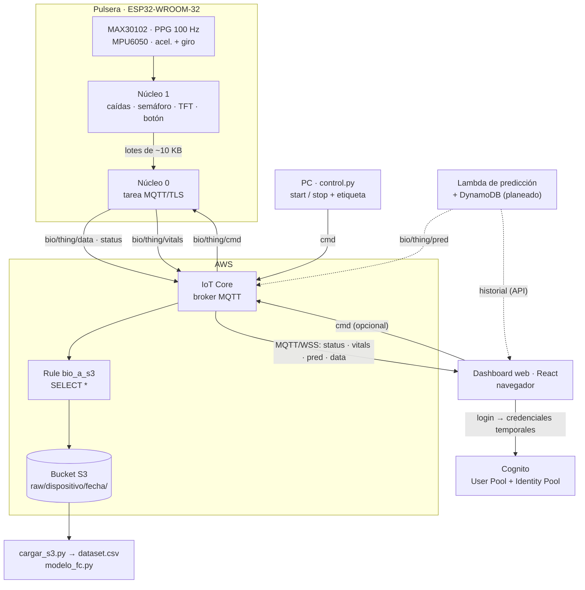
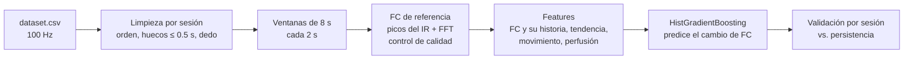

# PulsoSeguro

Pulsera IoT basada en ESP32 que monitorea **frecuencia cardiaca (FC)** y **SpO₂** con un MAX30102 y **detecta caídas** con un MPU6050. Muestra los datos en una pantalla TFT, envía las señales crudas a **AWS IoT Core → S3** para entrenar un modelo de **predicción de FC** en Python y tiene un **dashboard web** en React para ver la pulsera en vivo.

## Estado del proyecto

| Componente | Estado |
|---|---|
| Firmware v4: caídas, semáforo de FC/SpO₂, pantalla TFT, dashboard web y captura a AWS | ✅ Funcional (pruebas P3, P4, P8 y P19) |
| Firmware v5: sin potenciómetro, LED RGB ni punto de acceso (umbral de impacto fijo en 1.5 g) | 🟡 Compila; pendiente validar en la placa y repetir P3 |
| Captura de señales a AWS IoT Core (MQTT/TLS) → S3 | ✅ Funcional con datos reales |
| Carga del dataset en pandas (`cargar_s3.py`) | ✅ Funcional |
| FC de referencia a partir del PPG | ✅ 93-100 % de ventanas válidas en reposo |
| Modelo de predicción de FC (+10 s) | 🟡 Pipeline listo; **todavía no supera a la línea base** por falta de datos ([resultados](#resultados-actuales)) |
| FC durante movimiento (filtrado de artefactos con el acelerómetro) | ⏳ Pendiente |
| Dashboard web (React): login con Cognito, monitor en vivo, diseño editable | ✅ Funcional en modo demo; ⏳ falta conectarlo a AWS IoT ([pasos](#configuración-de-aws-para-el-dashboard)) |
| Tópico `vitals` (FC, SpO₂, caída y semáforo) en el firmware v7 | 🟡 Compila; falta probarlo en la placa |
| Lambda de predicción en vivo (`pred` + DynamoDB) | 🟡 Lista y probada con moto ([README_prediccion.md](README_prediccion.md)); falta desplegarla. API del historial 🟡 lista (`lambda/api/`, opcional en la misma pila) |

## Contenido

- [Arquitectura](#arquitectura)
- [Hardware](#hardware)
- [Firmware](#firmware)
- [Captura de datos en AWS](#captura-de-datos-en-aws)
- [Configuración de AWS IoT Core](#configuración-de-aws-iot-core)
- [Herramientas en Python](#herramientas-en-python)
- [Modelo de predicción de FC](#modelo-de-predicción-de-fc)
- [Dashboard web](#dashboard-web)
- [Costos](#costos)
- [Solución de problemas](#solución-de-problemas)
- [Seguridad](#seguridad)
- [Siguientes pasos](#siguientes-pasos)
- [Estructura del repositorio](#estructura-del-repositorio)

## Arquitectura



Las líneas punteadas son partes que todavía no existen.

- **Wi-Fi solo en modo estación (STA).** El ESP32 se conecta a un router con internet para llegar a AWS. Desde la versión 5 ya no crea su propia red ni sirve el dashboard web: la información local se ve en la pantalla TFT.
- **Dos núcleos.** Una reconexión TLS bloquea de 1 a 3 s, y la detección de caídas lee el MPU6050 cada 10 ms. Por eso MQTT corre en una tarea de FreeRTOS en el núcleo 0, y la lógica de la pulsera nunca espera a la red.
- **El broker no guarda datos.** Una Rule de IoT Core escribe cada lote como un archivo en S3, sin servicios intermedios.
- **El dashboard no tiene backend propio.** El navegador se conecta directo a IoT Core con credenciales temporales de Cognito; nunca usa los certificados del ESP32.

## Hardware

| Componente | Conexión (ESP32-WROOM-32) |
|---|---|
| MPU6050 (I²C `0x68`) | SDA = GPIO 21, SCL = GPIO 22 |
| MAX30102 (I²C `0x57`) | Mismo bus I²C |
| Pantalla TFT 2.8" ST7789 240×320 (SPI) | CS = 15, DC = 16, RST = 4, MOSI = 23, SCK = 18, BLK = 32, VCC = 3V3 |
| Botón | GPIO 27 → GND (`INPUT_PULLUP`) |
| Buzzer pasivo | GPIO 13 |

> La línea DC de la pantalla se movió de GPIO 2 a GPIO 16. El GPIO 2 es un *strapping pin*: si está en HIGH al arrancar, impide cargar código.
>
> En la versión 5 se quitaron del circuito el potenciómetro (antes GPIO 34) y el LED RGB (antes GPIO 25, 26 y 33). Los demás pines no cambiaron.

## Firmware

| Carpeta | Placa | Para qué sirve |
|---|---|---|
| `firmware/pulso_seguro_aws/` | ESP32-WROOM-32 | **Firmware principal** (v5): toda la funcionalidad de la pulsera (caídas, semáforo, TFT, botón y buzzer) más la captura a AWS en una tarea del núcleo 0 |
| `firmware/esp32_aws/` | ESP32-S3 | Solo captura: lee el MAX30102 y el MPU6050 (I²C en SDA = GPIO 8, SCL = GPIO 9) y publica los lotes en AWS. Sin pantalla ni detección de caídas. Lotes de 24.5 KB y cola de 40 lotes (~2 min) en PSRAM; sin PSRAM, la cola baja a 2 lotes |
| `firmware/esp32_aws_sim/` | ESP32-S3 | Mismo protocolo que `esp32_aws`, pero **sin sensores**: genera a 100 Hz señales sintéticas de PPG e IMU. Sirve para probar la conectividad y el pipeline completo (S3 → pandas) |

Cada carpeta tiene su propio `secrets.h.example`; el `secrets.h` debe quedar junto al `.ino` que vas a compilar.

**Firmware simulado (`esp32_aws_sim`).** La señal depende de la etiqueta que manda `control.py` en `start`:

| La etiqueta contiene | FC simulada | Movimiento |
|---|---|---|
| `correr` | ~145 lpm | Fuerte |
| `caminar` | ~100 lpm | Moderado |
| cualquier otra | ~70 lpm (reposo) | Ninguno |

Con `#define AUTO_START 1`, el ESP32 empieza a transmitir solo al conectarse (etiqueta `sim_reposo`) durante `AUTO_START_SEG` segundos, sin necesidad de `control.py`. El monitor serie reporta lotes enviados, encolados, muestras perdidas y reconexiones.

### Funciones de la pulsera

| Regla | Comportamiento |
|---|---|
| R1 | Caída en 4 fases: caída libre (< 0.7 g) → impacto (> 1.5 g, umbral fijo) → inmovilidad (±0.3 g durante 0.5-2.5 s) → cambio de orientación (≥ 60°) |
| R2 | 15 s para cancelar; si no se cancela, alarma completa (máximo 60 s de sonido) |
| R3 | Semáforo de FC (verde 60-100, amarillo 50-120 lpm) y SpO₂ (verde ≥ 95 %, amarillo ≥ 90 %) en la pantalla |
| R4 | Pulsación corta (< 1 s): silencia o cancela |
| R5 | Pulsación larga (3 s): botón de pánico |

R6 (sensibilidad con el potenciómetro) y R7 (botón «Silenciar» en el dashboard) se eliminaron en la versión 5. El umbral de impacto quedó fijo en 1.5 g (`UMBRAL_IMPACTO_G`), el valor de máxima sensibilidad, porque en P3 los picos de las caídas fueron de 1.67-2.22 g. La alarma solo se silencia con el botón.

La pantalla muestra el estado y su cuenta regresiva, la FC y la SpO₂ con el color del semáforo, el umbral de impacto, el último evento y, en el encabezado, el estado de Wi-Fi y de AWS (`OK`, `REC` mientras graba). La pantalla redibuja una sola región por vuelta del `loop()` y no se actualiza mientras se analiza un posible impacto, para no perder muestras del pico.

**Valores medidos en las pruebas:**
- P3: en caídas del brazo, caída libre de 0.26-0.56 g, pico de 1.67-2.22 g y cambio de orientación de 70-87°. En saltos, la orientación cambia solo 1-9°.
- P4: con brillo 100 y rango de ADC 16384, el IR con dedo es de ≈ 118 000 (sin dedo, ≈ 700). La FC por detección de latidos se mantiene estable en 67-76 lpm.

### Compilar

1. Placa: **ESP32 Dev Module** para `pulso_seguro_aws`, o **ESP32S3 Dev Module** para `esp32_aws` y `esp32_aws_sim` (paquete `esp32` de Espressif 3.x).
2. **Tools → Partition Scheme → "Huge APP (3MB No OTA/1MB SPIFFS)"**. Con TLS, el programa no cabe en la partición por defecto de 1.2 MB.
3. Librerías (Gestor de librerías del IDE de Arduino):

   | Librería | `pulso_seguro_aws` | `esp32_aws` | `esp32_aws_sim` |
   |---|:-:|:-:|:-:|
   | **PubSubClient** (Nick O'Leary) | ✓ | ✓ | ✓ |
   | SparkFun MAX3010x Pulse and Proximity Sensor | ✓ | ✓ | |
   | Adafruit GFX | ✓ | | |
   | Adafruit ST7735 and ST7789 | ✓ | | |
   | Adafruit MPU6050 | | ✓ | |

   `pulso_seguro_aws` lee el MPU6050 directamente por registros, sin librería.
4. Copia `secrets.h.example` como `secrets.h` en la carpeta del sketch y llena `WIFI_SSID`, `WIFI_PASS`, `THING_NAME`, `AWS_ENDPOINT` y los tres certificados ([ver Seguridad](#seguridad)).

## Captura de datos en AWS

### Tópicos MQTT

| Tópico | Quién publica | Contenido |
|---|---|---|
| `bio/<THING_NAME>/data` | ESP32 | Lotes CSV de ~10 KB (~1.5 s de señal) |
| `bio/<THING_NAME>/cmd` | PC (`control.py`) | `{"cmd":"start","sesion":…,"label":…,"sujeto":…}` o `{"cmd":"stop"}` |
| `bio/<THING_NAME>/status` | ESP32 (y AWS como Last Will) | `online` / `offline`, retenido |
| `bio/<THING_NAME>/vitals` | ESP32 (v7) | JSON al cambiar (máx. 1 Hz, mín. cada 5 s) con FC, SpO₂, contacto, caída, pánico y semáforo ([formato](#tópicos-que-usa-el-dashboard)) |
| `bio/<THING_NAME>/pred` | Lambda | JSON cada 2 s con la FC predicha ([formato](#tópicos-que-usa-el-dashboard)) |

### Formato de cada lote

```text
#20261110_222453,reposo,s01
seq,t_ms,red,ir,ax,ay,az,gx,gy,gz
0,51234,88213,110584,0.4120,-0.1031,9.7712,0.0012,-0.0040,0.0007
...
```

- Hay una fila por cada muestra del MAX30102 (**100 Hz**), junto con la última lectura del MPU6050. El acelerómetro va en m/s² y el giroscopio en rad/s.
- `seq` es consecutivo dentro de la sesión. Un hueco en `seq` indica una muestra perdida.
- La primera línea (`#sesion,label,sujeto`) hace que cada archivo en S3 se explique solo.

### Decisiones de diseño

- **Lotes de ~10 KB.** IoT Core cobra en bloques de 5 KB, así que un lote de 9.7 KB cuenta como 2 mensajes. Los lotes grandes generan menos archivos en S3. En el ESP32-S3 con PSRAM se usaron 24.5 KB; el WROOM-32 no tiene PSRAM y por eso usa 10 KB.
- **Cola de 5 lotes en RAM (~8 s).** Si AWS no responde, las muestras nuevas se descartan sin bloquear la pulsera, y la pérdida queda registrada en `seq`.
- **La etiqueta viaja dentro de los datos**, no en el tópico. Así se pueden agregar actividades nuevas sin cambiar el firmware.

## Configuración de AWS IoT Core

Todo el proyecto usa la región **`us-east-2`** (Cognito, IoT Core, S3 y lo que se agregue). Todo cabe en el plan gratuito; ver [Costos](#costos).

1. **Política IoT `bio-policy`.** Reemplaza `<ACCOUNT_ID>` en los tres recursos. El `Subscribe` usa `topicfilter/`, no `topic/`.

   ```json
   {
     "Version": "2012-10-17",
     "Statement": [
       { "Effect": "Allow", "Action": "iot:Connect",
         "Resource": "arn:aws:iot:us-east-2:<ACCOUNT_ID>:client/${iot:Connection.Thing.ThingName}" },
       { "Effect": "Allow", "Action": ["iot:Publish", "iot:Receive", "iot:RetainPublish"],
         "Resource": "arn:aws:iot:us-east-2:<ACCOUNT_ID>:topic/bio/*" },
       { "Effect": "Allow", "Action": "iot:Subscribe",
         "Resource": "arn:aws:iot:us-east-2:<ACCOUNT_ID>:topicfilter/bio/*" }
     ]
   }
   ```

2. **Things y certificados.** Crea un Thing por cliente: uno para la pulsera y `pc-captura` para el script. Cada uno lleva su certificado con la política adjunta. El *client ID* tiene que ser igual al nombre del Thing.
3. **Endpoint.** Usa el que termina en `-ats`: `aws iot describe-endpoint --endpoint-type iot:Data-ATS`.
4. **Bucket S3** con el acceso público bloqueado.
5. **Rule `bio_a_s3`.** Usa `SELECT * FROM 'bio/+/data'` con la acción *Amazon S3 bucket* y esta llave:

   ```text
   raw/${topic(2)}/${parse_time("yyyy/MM/dd/HH", timestamp(), "UTC")}/${timestamp()}_${newuuid()}.csv
   ```

> **Amazon Data Firehose no está disponible** en las cuentas con el plan gratuito nuevo. Por eso la Rule escribe directo a S3.

## Herramientas en Python

```bash
python -m venv .venv
.venv\Scripts\activate             # Windows  (Linux/macOS: source .venv/bin/activate)
pip install -r requirements.txt    # modelo: pandas, numpy, scipy, scikit-learn, matplotlib, joblib
pip install paho-mqtt boto3        # herramientas de captura
```

| Script | Qué hace |
|---|---|
| `herramientas/control.py` | Se conecta como `pc-captura`, manda `start` con la sesión (fecha y hora), la etiqueta y el sujeto; espera la duración y manda `stop` (también al interrumpir con `Ctrl+C`). Muestra el estado `online`/`offline` del dispositivo |
| `herramientas/cargar_s3.py` | Descarga en paralelo (16 hilos) todos los lotes bajo `raw/` del bucket, interpreta los encabezados, elimina duplicados, ordena por `seq` y genera `dataset.csv` en la carpeta actual, con un resumen de muestras perdidas por sesión |

```bash
python herramientas/control.py --label reposo --sujeto s01 --duracion 60 --monitor
python herramientas/cargar_s3.py
```

| Opción de `control.py` | Default | Descripción |
|---|---|---|
| `--label` | (obligatoria) | Actividad de la sesión: `reposo`, `caminar`, `correr`… |
| `--sujeto` | `s01` | Identificador anónimo de la persona |
| `--duracion` | `60` | Segundos entre `start` y `stop` |
| `--monitor` | apagado | Se suscribe a `bio/<dispositivo>/data` y cuenta los lotes que llegan |

Para filtrar un solo dispositivo o día en `cargar_s3.py`, cambia la constante `PREFIJO` (por ejemplo, `raw/esp32s3-01/2026/11/10/`).

### Variables de entorno

Los scripts leen los datos de tu cuenta de variables de entorno, para no dejarlos en el código:

| Variable | Script | Valor |
|---|---|---|
| `AWS_IOT_ENDPOINT` | `control.py` | Endpoint `-ats` de IoT Core |
| `AWS_IOT_DEVICE` | `control.py` | Nombre del Thing de la pulsera (el `THING_NAME` del firmware) |
| `AWS_IOT_CA_CERTS` | `control.py` | Ruta a `AmazonRootCA1.pem` |
| `AWS_IOT_CERTFILE` | `control.py` | Ruta al certificado del Thing `pc-captura` |
| `AWS_IOT_KEYFILE` | `control.py` | Ruta a la llave privada de `pc-captura` |
| `S3_BUCKET` | `cargar_s3.py` | Nombre del bucket donde escribe la Rule |

`cargar_s3.py` usa las credenciales normales de `boto3` (`aws configure`, o `AWS_ACCESS_KEY_ID` / `AWS_SECRET_ACCESS_KEY`), con permiso de `s3:ListBucket` y `s3:GetObject` sobre el bucket.

```powershell
# PowerShell
$env:AWS_IOT_ENDPOINT = "abc123xyz-ats.iot.us-east-2.amazonaws.com"
$env:AWS_IOT_DEVICE   = "esp32s3-01"
$env:AWS_IOT_CA_CERTS = "certs/AmazonRootCA1.pem"
$env:AWS_IOT_CERTFILE = "certs/pc-captura.cert.pem"
$env:AWS_IOT_KEYFILE  = "certs/pc-captura.private.key"
$env:S3_BUCKET        = "mi-bucket-pulso-seguro"
```

## Modelo de predicción de FC

`modelo/modelo_fc.py` usa los datos hasta el instante *t* para predecir **la FC que medirá la pulsera en t + 10 s**.

```bash
python modelo/modelo_fc.py dataset.csv                  # tus datos
python modelo/modelo_fc.py dataset.csv --horizonte 20   # 20 s adelante (múltiplo de 2)
python modelo/modelo_fc.py dataset.csv --salida otra/   # otra carpeta de salida (default salida_fc/)
python modelo/modelo_fc.py --demo                       # datos sintéticos
```



### Cómo funciona

- **FC de referencia.** Los datos no traen una FC "real", así que se calcula del PPG:
  - El IR se filtra entre 0.5 y 4 Hz.
  - La FFT da el periodo esperado, y no se aceptan dos picos a menos del 60 % de ese periodo. Esto evita contar la muesca dicrota como latido.
  - La FC es la mediana de los intervalos entre picos.
  - La ventana solo se acepta si la variación de intervalos es < 0.15 y si los picos coinciden con la FFT (±10 lpm).
- **Objetivo.** El modelo predice el *cambio* de FC. La idea es aprovechar el acelerómetro para anticipar subidas antes de que ocurran.
- **Líneas base.** El modelo se compara contra la **persistencia** («la FC no cambia») y contra la media de las últimas 3 ventanas. Si no supera a la persistencia, todavía no sirve.
- **Validación.** Se usa `GroupKFold` **por sesión**, nunca filas al azar. Las ventanas consecutivas se parecen tanto que una división al azar inflaría las métricas.
- **Salidas en `salida_fc/`:**
  - El modelo (`modelo_fc.joblib`, con las features y el horizonte), `metricas.json` y `predicciones_validacion.csv`.
  - Un diagnóstico de calidad por sesión (`calidad_sesiones.csv`).
  - 5 gráficas: la señal con los latidos detectados, la FC en el tiempo, el error por actividad, la importancia de las features y las ventanas rechazadas.

### Resultados actuales

Primer dataset real (10/11/2026): 1 sujeto, 5 sesiones de 60 s, una sola actividad por sesión.

| Sesión | Ventanas con FC válida | Motivo de rechazo |
|---|---|---|
| reposo ×3 | 93 %, 96 %, 100 % | — |
| caminar | 44 % | Intervalos irregulares (artefactos de movimiento) |
| correr | 15 % | Intervalos irregulares (artefactos de movimiento) |

| Predicción a +10 s (65 ventanas) | MAE | RMSE |
|---|---|---|
| Modelo | 4.43 lpm | 5.70 lpm |
| Persistencia | 3.54 lpm | 4.73 lpm |
| Media de 3 ventanas | **3.17 lpm** | **4.14 lpm** |

**Lectura de los resultados:**
- En reposo, la FC solo fluctúa ±3 lpm. Como no hay cambios que anticipar, la mejor predicción es un promedio.
- Con 65 ventanas y sin transiciones de actividad, el modelo no tiene un patrón que aprender.
- Con datos sintéticos que sí tienen transiciones, el mismo pipeline reduce el error de la persistencia en ~48 % (2.1 contra 4.1 lpm). Ese resultado solo demuestra que el pipeline funciona; no dice nada sobre el desempeño con datos reales.

### Lecciones aprendidas

- La primera versión del detector de latidos aceptaba solo el 18-59 % de las ventanas en reposo, porque contaba ruido y la muesca dicrota como latidos. La regla de distancia mínima basada en la FFT lo subió a 93-100 %.
- Sostener el sensor con el dedo mientras te mueves no funciona: la mayoría de las ventanas sale irregular. El sensor necesita ir fijo al cuerpo, con presión constante.
- La FC medida en la sesión «correr» (75-82 lpm) está en rango de reposo. Hay que confirmar si el esfuerzo realmente subió la FC o si lo que domina la señal es el braceo.

## Dashboard web

`dashboard/` es una aplicación de una sola página en **React 19 + TypeScript + Vite**. El usuario inicia sesión con **Cognito** y el navegador recibe los datos de la pulsera de **AWS IoT Core por MQTT sobre WebSocket**. Mientras no existan los tópicos `vitals` y `pred`, el **modo demo** simula los mismos mensajes en el navegador.

### Qué muestra

| Panel | Contenido | Fuente |
|---|---|---|
| Estado general | Semáforo que decide el ESP32: **verde** normal, **naranja** levemente fuera del promedio, **rojo** fuera de rango. Toda la tarjeta se tiñe | `vitals.semaforo` |
| Frecuencia cardiaca | Valor, predicción a +10 s y un **corazón que late** a 60/FC s por latido | `vitals.fc`, `pred` |
| SpO₂ | Valor y **burbujas que suben** a la superficie (oxigenación) | `vitals.spo2` |
| Sensor | Verde con contacto, rojo sin contacto | `vitals.dedo` |
| Aviso de caída | Banda roja mientras dure la caída, con la hora en que empezó | `vitals.caida` |
| Tendencias en vivo | FC medida contra FC predicha (cada predicción se dibuja en el instante que predice) y SpO₂, en ventanas de 1, 5 o 10 min | Historial en memoria de `vitals` y `pred` |
| Eventos recientes | Caída, semáforo en rojo, pérdida de contacto, pulsera conectada o desconectada | Calculado en el navegador |
| Onda de pulso (PPG) | Canal IR de los últimos 6 s y muestras perdidas. **Apagada por defecto** por costo | `data` |
| Sesión de captura | Equivalente web de `control.py`: `start` con actividad, sujeto y duración, y `stop`. Solo con `VITE_ENABLE_CMD=true` | Publica en `cmd` |
| Historial de predicciones | FC medida contra FC predicha de la última 1, 6 o 24 h (donde se separan está el error del modelo). Solo con `VITE_HISTORY_API_URL` | API → DynamoDB |

- **Diseño editable.** «Editar diseño» permite mover y redimensionar cada tarjeta y panel. El contenido se adapta al tamaño (texto, ilustraciones y gráficas). El diseño se guarda en el navegador por usuario y «Restablecer diseño» vuelve al original. En móvil se usa una sola columna fija.
- **Accesibilidad.** Tema claro y oscuro automático; los colores de estado siempre van con ícono y texto; las gráficas tienen tooltip y vista de tabla. Si el sistema pide *reducir movimiento* (en Windows, *Efectos de animación* apagados), el corazón y las burbujas solo cambian de brillo.
- **Varias pulseras.** Con más de un nombre en `VITE_THING_NAMES` aparece un selector en el encabezado.

### Tópicos que usa el dashboard

| Tópico | El dashboard… | Formato |
|---|---|---|
| `bio/<thing>/status` | se suscribe | Texto `online` / `offline`, retenido |
| `bio/<thing>/vitals` | se suscribe | JSON al cambiar (máx. 1 Hz) o cada 5 s |
| `bio/<thing>/pred` | se suscribe | JSON cada 2 s |
| `bio/<thing>/data` | se suscribe solo si se activa «Recibir señal cruda» | CSV de ~10 KB ([formato](#formato-de-cada-lote)) |
| `bio/<thing>/cmd` | publica (opcional) | `{"cmd":"start","sesion":…,"label":…,"sujeto":…}` o `{"cmd":"stop"}` |

```jsonc
// bio/<thing>/vitals: el ESP32 decide el semáforo; el dashboard no recalcula umbrales
{"ts":1763086800000,"fc":78,"spo2":97,"dedo":true,"caida":false,"panico":false,"semaforo":"verde"}

// bio/<thing>/pred: la Lambda lo publica y también lo guarda en DynamoDB.
// El ESP32 lee fc_prevista y semaforo; el dashboard, ts, fc_pred y horizonte_s.
{"fc_prevista":92.4,"semaforo":"verde","ts":1763086802000,"win":54,"fc":88.1,
 "fc_pred":92.4,"horizonte_s":10,"modelo":"20261112-030721","usado":"ridge"}
```

- `ts` es epoch en ms (el ESP32 lo obtiene por NTP; manda `0` mientras no tiene hora y el dashboard usa la de recepción). `fc` y `spo2` son `null` si no hay lectura válida. `semaforo` es `"verde"`, `"amarillo"` o `"rojo"` (el amarillo se muestra en naranja): el peor entre FC y SpO₂, y `"amarillo"` sin lectura. La caída y el pánico no cambian el semáforo; van en `caida` y `panico` (el dashboard todavía no muestra `panico`).
- Los tipos están en `dashboard/src/tipos.ts` y el enrutado por tópico en `dashboard/src/telemetria/estado.ts`.
- La Rule `bio_a_s3` filtra `bio/+/data`, así que `vitals` y `pred` no llegan a S3.

### Cómo se conecta

1. Login con el **User Pool** (OIDC, *authorization code*) mediante `react-oidc-context`.
2. Con el `id_token`, el navegador pide al **Identity Pool** credenciales temporales (`GetId` + `GetCredentialsForIdentity`).
3. Firma con **SigV4** la URL `wss://<endpoint>/mqtt` (servicio `iotdevicegateway`) y se conecta con `mqtt.js` usando el *client ID* `web-<uuid>`.
4. Si la conexión se cae, vuelve a firmar y reconecta con espera exponencial; renueva las credenciales 5 min antes de que expiren.

No usa el AWS SDK: las llamadas a Cognito y la firma están en `dashboard/src/aws/`. `mqtt.js` se carga solo cuando hace falta, así que el modo demo no lo descarga.

### Configuración

Vite **incrusta las variables `VITE_*` al compilar**. Copia `dashboard/.env.example` según cómo lo ejecutes:

| Archivo | Lo usa | Notas |
|---|---|---|
| `dashboard/.env` | `pnpm dev` y `docker compose up dashboard-dev` | Modo desarrollo: **no** lee `.env.production` |
| `dashboard/.env.production` | `docker build` / `docker compose up dashboard` | Entra al contexto de Docker (está en `.gitignore`, pero no en `.dockerignore`). No declares `VITE_*` en el Dockerfile: aunque estén vacías, pisan este archivo |

| Variable | Obligatoria | Valor |
|---|---|---|
| `VITE_AUTHORITY` | Sí | Issuer del User Pool: `https://cognito-idp.us-east-2.amazonaws.com/<userPoolId>` |
| `VITE_CLIENT_ID` | Sí | App client del User Pool |
| `VITE_REDIRECT_URI` | Sí | URL de callback, p. ej. `http://localhost:5173/` |
| `VITE_LOGOUT_URI` | Sí | Debe coincidir **exactamente** con una *Allowed sign-out URL* del App client |
| `VITE_COGNITO_DOMAIN` | Sí | Dominio del *managed login*, `https://<prefijo>.auth.us-east-2.amazoncognito.com` |
| `VITE_AWS_REGION` | No | `us-east-2` por defecto |
| `VITE_IDENTITY_POOL_ID` | Sí, para datos reales | `us-east-2:<uuid>` |
| `VITE_IOT_ENDPOINT` | Sí, para datos reales | `<prefijo>-ats.iot.us-east-2.amazonaws.com`, sin `wss://` ni `/mqtt` |
| `VITE_THING_NAMES` | Sí, para datos reales | Uno o varios `THING_NAME` separados por coma |
| `VITE_HISTORY_API_URL` | No | API del historial de predicciones |
| `VITE_ENABLE_CMD` | No | `true` muestra el panel de sesión de captura |
| `VITE_DEMO` | No | `true` simula los datos; con `VITE_AUTHORITY` vacío también omite el login |
| `PORT`, `ALLOWED_HOSTS` | No | Servidor de desarrollo de Vite |

### Ejecutar

```bash
cd dashboard
pnpm install
pnpm dev                                   # http://localhost:5173 con .env
pnpm lint && pnpm build                    # verificación (TypeScript + ESLint + build)

docker compose up --build dashboard        # producción (nginx) en http://localhost:8080, con .env.production
docker compose up --build dashboard-dev    # Vite con recarga, con .env
```

Modo demo sin AWS ni login (PowerShell):

```powershell
$env:VITE_DEMO="true"; $env:VITE_AUTHORITY=""; pnpm dev
```

En la demo, «Sesión de captura» con la actividad `correr` sube la FC hasta ~145 lpm (el semáforo pasa por verde, naranja y rojo), y los botones «Simular sin contacto» y «Simular caída» prueban esos estados.

### Configuración de AWS para el dashboard

> Pendiente: estos pasos todavía no se han hecho en la cuenta. Todo va en `us-east-2`.

1. **App client del User Pool** (*Login pages*): proveedor *Cognito user pool directory*, grant *Authorization code*, scopes `openid`, `email` y `phone`, la *Callback URL* (`http://localhost:5173/`) y en *Allowed sign-out URLs* exactamente el valor de `VITE_LOGOUT_URI`. Agrega también las URLs de producción.
2. **Identity Pool** con el User Pool y su App client como proveedor autenticado. Su ID va en `VITE_IDENTITY_POOL_ID`.
3. **Rol IAM autenticado** del Identity Pool con esta política (quita `data` si no usarás la onda PPG y el `Publish` si no usarás el panel de captura):

   ```json
   {
     "Version": "2012-10-17",
     "Statement": [
       { "Effect": "Allow", "Action": "iot:Connect",
         "Resource": "arn:aws:iot:us-east-2:<ACCOUNT_ID>:client/${cognito-identity.amazonaws.com:sub}-*" },
       { "Effect": "Allow", "Action": "iot:Subscribe",
         "Resource": [
           "arn:aws:iot:us-east-2:<ACCOUNT_ID>:topicfilter/bio/*/status",
           "arn:aws:iot:us-east-2:<ACCOUNT_ID>:topicfilter/bio/*/vitals",
           "arn:aws:iot:us-east-2:<ACCOUNT_ID>:topicfilter/bio/*/pred",
           "arn:aws:iot:us-east-2:<ACCOUNT_ID>:topicfilter/bio/*/data" ] },
       { "Effect": "Allow", "Action": "iot:Receive",
         "Resource": [
           "arn:aws:iot:us-east-2:<ACCOUNT_ID>:topic/bio/*/status",
           "arn:aws:iot:us-east-2:<ACCOUNT_ID>:topic/bio/*/vitals",
           "arn:aws:iot:us-east-2:<ACCOUNT_ID>:topic/bio/*/pred",
           "arn:aws:iot:us-east-2:<ACCOUNT_ID>:topic/bio/*/data" ] },
       { "Effect": "Allow", "Action": "iot:Publish",
         "Resource": "arn:aws:iot:us-east-2:<ACCOUNT_ID>:topic/bio/*/cmd" }
     ]
   }
   ```

   `bio-policy` no sirve para el navegador: `${iot:Connection.Thing.ThingName}` solo funciona con conexiones por certificado.

   El dashboard se conecta con el *client ID* `<identityId>-<uuid>`, y `${cognito-identity.amazonaws.com:sub}` es ese identityId: cada usuario solo puede usar client IDs con su propia identidad, así nadie puede desconectar a otro reutilizando su client ID. Si no darás el `Publish` sobre `cmd`, no uses el panel «Sesión de captura»: una publicación no autorizada hace que IoT cierre la conexión.

4. **Política IoT del dashboard** (por ejemplo `dashboard-policy`) con el mismo documento, **adjunta a cada identidad de Cognito**. Con identidades autenticadas, IoT exige las dos políticas; sin esta, cierra la conexión sin explicar. El dashboard muestra el *Identity ID* en el aviso de error:

   ```bash
   aws iot create-policy --policy-name dashboard-policy --policy-document file://dashboard-policy.json --region us-east-2
   aws iot attach-policy --policy-name dashboard-policy --target <identityId> --region us-east-2
   ```

5. **Endpoint** `-ats` (`aws iot describe-endpoint --endpoint-type iot:Data-ATS --region us-east-2`) en `VITE_IOT_ENDPOINT`, y los `THING_NAME` en `VITE_THING_NAMES`.

### API del historial

Es una HTTP API de API Gateway con autorizador JWT de Cognito y una Lambda de solo lectura (`lambda/api/api_historial.py`). Se crea en la misma pila de `infra/template.yaml` cuando le das el User Pool:

```powershell
.\infra\desplegar.ps1 -Modelo modelo_fc.json -Bucket <bucket> -UserPoolId <user pool id> -ClientId <app client id> `
    -Origenes "http://localhost:5173,http://localhost:8080,https://<dominio del dashboard>"
```

La salida `UrlApiHistorial` es el valor de `VITE_HISTORY_API_URL`. Contrato:

```text
GET {VITE_HISTORY_API_URL}/predicciones?thing=<thing>&desde=<ms>&hasta=<ms>     (rango máximo 24 h)
Authorization: Bearer <id_token>
→ { "items": [{ "ts", "fc_pred", "horizonte_s", "modelo", "fc", "fc_real"?, "usado" }], "total", "truncado" }
```

- `fc_real` es la FC medida 10 s después; falta en las predicciones de los últimos 10 s.
- La tabla tiene 5 RCU aprovisionadas. Por eso la API lee como máximo 5,000 ítems (~2.8 h con la pulsera puesta todo el tiempo), empezando por los más recientes, y devuelve `truncado: true` si quedaron más. Responde con 720 puntos como máximo (promedios). La etapa limita a 2 peticiones/s.
- Cualquier usuario del User Pool puede consultar cualquier `thing`. Para un proyecto con varios pacientes habría que asociar usuarios a pulseras.
- Prueba local: `python lambda/test_api.py`.

## Costos

Con lotes de ~10 KB, una hora de captura genera unos **2,400 lotes**. Cada lote cuenta como 2 mensajes de IoT Core (se cobra en bloques de 5 KB) y produce una escritura en S3. Al precio de pago serían centavos de dólar por hora de grabación. En una cuenta del plan gratuito se descuenta de los créditos.

- Crea una alerta en **AWS Budgets** de 1 USD antes de conectar cualquier dispositivo.
- No dejes la pulsera transmitiendo sin necesidad: manda siempre `stop` al terminar cada sesión.
- **Dashboard:** IoT Core cobra cada entrega a cada suscriptor. `vitals` a 1 Hz son 3,600 mensajes/h publicados **más 3,600/h por cada pestaña abierta**. Recibir `data` suma ~2,400 entregas/h de ~10 KB (2 bloques de 5 KB cada una); por eso la onda PPG está apagada por defecto.

## Solución de problemas

| Síntoma | Causa | Solución |
|---|---|---|
| Python: `getaddrinfo failed` | El endpoint está mal escrito (sigue el de ejemplo, o tiene `https://` o `/`) | Copia el endpoint `-ats` tal cual y pruébalo con `nslookup` |
| Python: `Conectado: Success` dos veces y luego `client is not currently connected` | La política rechaza el `Subscribe` o el `Publish`, y AWS cierra la conexión sin avisar | Revisa `<ACCOUNT_ID>`, la región, `topicfilter/` y la versión activa de la política |
| ESP32: `estado=-2` | La conexión TCP/TLS no se abrió | Revisa el diagnóstico `[DNS]`, `[TLS]` y `[RAM]` del monitor serie. `-0x7780` = certificado rechazado; `-0x2700` = CA o endpoint incorrectos |
| ESP32: desconexión inmediata o `estado=-4` | Problema de política o de *client ID* | `THING_NAME` debe ser igual al nombre del Thing, y cada cliente necesita su propio Thing |
| Arduino: `exit status 1` sin más detalles | El error está en el panel *Output* (`Ctrl+Shift+Y`) | Un error común: un `struct` usado en la firma de una función debe declararse **antes** de la primera función del `.ino`, porque el IDE inserta ahí los prototipos automáticos |
| `Sketch too big` | TLS no cabe en la partición de 1.2 MB | Usa el esquema de particiones *Huge APP* |
| Pocas ventanas con FC válida | Hay movimiento o el sensor tiene poca presión | Revisa la tabla de diagnóstico de `modelo_fc.py` y la figura `5_diagnostico_ventanas.png` |
| Dashboard: «Falta configuración» o no aparece el botón «Salir» con `pnpm dev` | El modo desarrollo lee `.env`, no `.env.production` | Crea `dashboard/.env` (puede ser copia de `.env.production`) y reinicia `pnpm dev` |
| Dashboard: «Invalid request» al cerrar sesión | `logout_uri` no coincide exactamente con las *Allowed sign-out URLs* (la `/` final cuenta) | Iguala `VITE_LOGOUT_URI` y la URL registrada en el App client |
| Dashboard: «Client is not enabled for OAuth2.0 flows» | El App client perdió su configuración OAuth | En *Login pages*: proveedor *Cognito user pool directory*, grant *Authorization code* y scopes |
| Dashboard: «AWS IoT cerró la conexión» | Falta la política IoT adjunta a la identidad de Cognito, o el rol IAM no permite el tópico | `aws iot attach-policy` con el *Identity ID* que muestra el aviso ([pasos](#configuración-de-aws-para-el-dashboard)) |
| Dashboard: el corazón y las burbujas solo cambian de brillo | El sistema pide *reducir movimiento* | Activa *Efectos de animación* en Windows (Accesibilidad → Efectos visuales) |
| Dashboard en Docker sin configuración | Hay `ARG`/`ENV VITE_*` en el Dockerfile o falta `.env.production` | Quita esas líneas; Vite debe leer `.env.production` |

## Seguridad

Nunca subas al repositorio `secrets.h`, la carpeta `certs/`, las llaves privadas, los `.env` / `.env.production` del dashboard ni los datasets con información de personas (`dataset.csv`, `datos/`, `salida_fc/`). El `.gitignore` ya los excluye.

- **Si subiste una llave privada por error**, desactiva ese certificado en *IoT Core → Security → Certificates* y crea uno nuevo. Borrar el commit no basta, porque la llave sigue en el historial y en los forks.
- **El dashboard nunca lleva certificados ni llaves.** Usa credenciales temporales de Cognito, limitadas por el rol IAM y la política IoT. No muestres tokens en pantalla ni en la consola.
- **Los datos fisiológicos son datos personales.** Usa identificadores como `s01` en lugar de nombres, y no publiques los CSV sin el consentimiento de los participantes.

## Siguientes pasos

- [ ] Validar el firmware v5 en la placa y repetir P3 con el umbral fijo de 1.5 g (10 caídas, 10 saltos, 10 movimientos cotidianos).
- [ ] Fijar el sensor a la muñeca o al dedo con presión constante.
- [ ] Grabar sesiones con transiciones (reposo → caminar → escaleras → reposo, ~4 min), de 2-3 personas, con al menos 6-8 sesiones en total.
- [ ] Validar la FC de referencia contra un oxímetro comercial.
- [ ] Filtrar los artefactos de movimiento usando el acelerómetro (restar sus frecuencias del espectro del PPG).
- [ ] Reentrenar y comparar contra la persistencia. Si el modelo la supera, evaluar cómo ejecutarlo en tiempo real.
- [ ] Firmware: publicar `bio/<thing>/vitals` a 1 Hz desde la tarea MQTT del núcleo 0 (requiere hora por NTP).
- [ ] AWS: Identity Pool, rol IAM, política IoT del dashboard y `VITE_IDENTITY_POOL_ID` / `VITE_IOT_ENDPOINT` / `VITE_THING_NAMES` ([pasos](#configuración-de-aws-para-el-dashboard)).
- [ ] Lambda de predicción: publicar en `bio/<thing>/pred` y guardar en DynamoDB; API Gateway para el historial.
- [ ] Probar el dashboard con la pulsera real y desplegarlo (agregar las URLs de producción en Cognito).

## Estructura del repositorio

```text
pulso-seguro/
├── firmware/
│   ├── pulso_seguro_aws/      # firmware principal de la pulsera (v5, ESP32-WROOM-32)
│   │   ├── pulso_seguro_aws.ino
│   │   └── secrets.h.example
│   ├── esp32_aws/             # solo captura de sensores a AWS (ESP32-S3)
│   │   ├── esp32_aws.ino
│   │   └── secrets.h.example
│   └── esp32_aws_sim/         # señales simuladas para probar AWS (ESP32-S3)
│       ├── esp32_aws_sim.ino
│       └── secrets.h.example
├── herramientas/
│   ├── control.py             # start / stop de sesiones por MQTT
│   └── cargar_s3.py           # S3 → dataset.csv
├── modelo/
│   └── modelo_fc.py           # predicción de FC
├── dashboard/                 # dashboard web (React + Vite)
│   ├── src/
│   │   ├── aws/               # Cognito Identity (credenciales) y firma SigV4
│   │   ├── telemetria/        # transporte MQTT, simulador demo, parsers y estado
│   │   ├── componentes/       # tarjetas, gráficas, onda PPG, paneles, cuadrícula
│   │   ├── diseno/            # diseño de la cuadrícula y su guardado
│   │   ├── utilidades/        # hora, tamaños
│   │   ├── config.ts          # variables VITE_*
│   │   ├── tipos.ts           # contratos de los tópicos
│   │   └── App.tsx, main.tsx  # login y arranque
│   ├── Dockerfile, nginx.conf, compose.yaml
│   └── .env.example
├── requirements.txt           # dependencias del modelo
├── AGENTS.md                  # estado del proyecto y guía para agentes de código
├── .gitignore
└── README.md
```

Archivos locales que no se suben (ver `.gitignore`): `certs/`, `.venv/`, `secrets.h`, `dataset.csv`, `salida_fc/`, `dashboard/.env` y `dashboard/.env.production`.