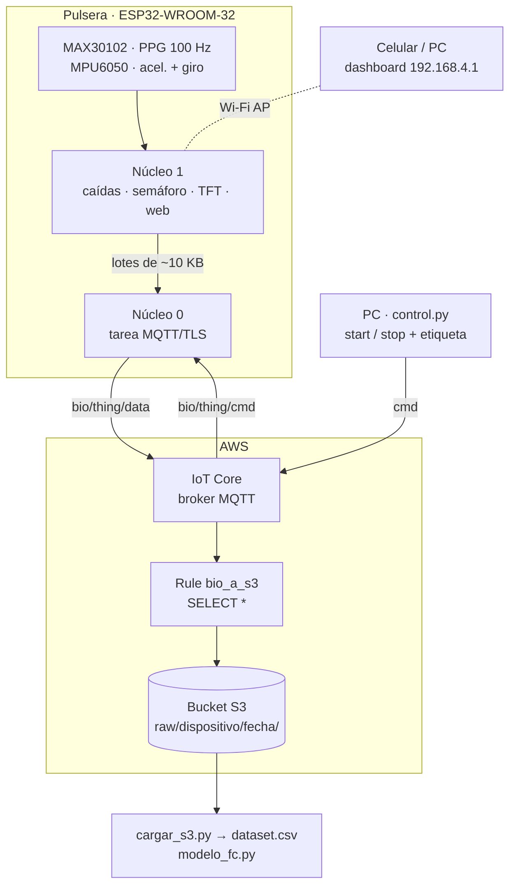
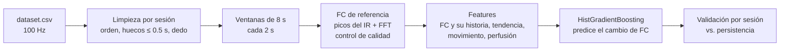

# PulsoSeguro

Pulsera IoT basada en ESP32 que monitorea **frecuencia cardiaca (FC)** y **SpO₂** con un MAX30102 y **detecta caídas** con un MPU6050. Muestra los datos en una pantalla TFT y en un dashboard web, y envía las señales crudas a **AWS IoT Core → S3** para entrenar un modelo de **predicción de FC** en Python.

## Estado del proyecto

| Componente | Estado |
|---|---|
| Firmware: caídas, semáforo de FC/SpO₂, pantalla TFT y dashboard web | ✅ Funcional (pruebas P3, P4, P8 y P19) |
| Captura de señales a AWS IoT Core (MQTT/TLS) → S3 | ✅ Funcional con datos reales |
| Carga del dataset en pandas (`cargar_s3.py`) | ✅ Funcional |
| FC de referencia a partir del PPG | ✅ 93-100 % de ventanas válidas en reposo |
| Modelo de predicción de FC (+10 s) | 🟡 Pipeline listo; **todavía no supera a la línea base** por falta de datos ([resultados](#resultados-actuales)) |
| FC durante movimiento (filtrado de artefactos con el acelerómetro) | ⏳ Pendiente |

## Contenido

- [Arquitectura](#arquitectura)
- [Hardware](#hardware)
- [Firmware](#firmware)
- [Captura de datos en AWS](#captura-de-datos-en-aws)
- [Configuración de AWS IoT Core](#configuración-de-aws-iot-core)
- [Herramientas en Python](#herramientas-en-python)
- [Modelo de predicción de FC](#modelo-de-predicción-de-fc)
- [Costos](#costos)
- [Solución de problemas](#solución-de-problemas)
- [Seguridad](#seguridad)
- [Siguientes pasos](#siguientes-pasos)
- [Estructura del repositorio](#estructura-del-repositorio)

## Arquitectura



- **Modo Wi-Fi AP + STA.** El ESP32 crea su propia red (`PulsoSeguro-ESP32`) para el dashboard y, al mismo tiempo, se conecta a un router con internet para llegar a AWS.
- **Dos núcleos.** Una reconexión TLS bloquea de 1 a 3 s, y la detección de caídas lee el MPU6050 cada 10 ms. Por eso MQTT corre en una tarea de FreeRTOS en el núcleo 0, y la lógica de la pulsera nunca espera a la red.
- **El broker no guarda datos.** Una Rule de IoT Core escribe cada lote como un archivo en S3, sin servicios intermedios.

## Hardware

| Componente | Conexión (ESP32-WROOM-32) |
|---|---|
| MPU6050 (I²C `0x68`) | SDA = GPIO 21, SCL = GPIO 22 |
| MAX30102 (I²C `0x57`) | Mismo bus I²C |
| Pantalla TFT 2.8" ST7789 240×320 (SPI) | CS = 15, DC = 16, RST = 4, MOSI = 23, SCK = 18, BLK = 32, VCC = 3V3 |
| Potenciómetro 10 kΩ | GPIO 34 (ADC1, solo entrada) |
| Botón | GPIO 27 → GND (`INPUT_PULLUP`) |
| LED RGB (cátodo común, 220 Ω) | R = 25, G = 26, B = 33 |
| Buzzer pasivo | GPIO 13 |

> La línea DC de la pantalla se movió de GPIO 2 a GPIO 16. El GPIO 2 es un *strapping pin*: si está en HIGH al arrancar, impide cargar código.

## Firmware

| Carpeta | Placa | Para qué sirve |
|---|---|---|
| `firmware/pulso_seguro_aws/` | ESP32-WROOM-32 | **Firmware principal** (v4): toda la funcionalidad de la pulsera (caídas, semáforo, TFT, dashboard) más la captura a AWS en una tarea del núcleo 0 |
| `firmware/esp32_aws/` | ESP32-S3 | Solo captura: lee el MAX30102 y el MPU6050 (I²C en SDA = GPIO 8, SCL = GPIO 9) y publica los lotes en AWS. Sin pantalla, dashboard ni detección de caídas. Lotes de 24.5 KB y cola de 40 lotes (~2 min) en PSRAM; sin PSRAM, la cola baja a 2 lotes |
| `firmware/esp32_aws_sim/` | ESP32-S3 | Mismo protocolo que `esp32_aws`, pero **sin sensores**: genera a 100 Hz señales sintéticas de PPG e IMU. Sirve para probar la conectividad y el pipeline completo (S3 → pandas) |

Cada carpeta tiene su propio `secrets.h.example`; el `secrets.h` debe quedar junto al `.ino` que vas a compilar.

**Firmware simulado (`esp32_aws_sim`).** La señal depende de la etiqueta que manda `control.py` en `start`:

| La etiqueta contiene | FC simulada | Movimiento |
|---|---|---|
| `correr` | ~145 lpm | Fuerte |
| `caminar` | ~100 lpm | Moderado |
| cualquier otra | ~70 lpm (reposo) | Ninguno |

Con `#define AUTO_START 1`, el ESP32 empieza a transmitir solo al conectarse (etiqueta `sim_reposo`) durante `AUTO_START_SEG` segundos, sin necesidad de `control.py`. El monitor serie reporta lotes enviados, encolados, muestras perdidas y reconexiones.

### Funciones de la pulsera

| Regla | Comportamiento |
|---|---|
| R1 | Caída en 4 fases: caída libre (< 0.7 g) → impacto (1.5-2.5 g) → inmovilidad (±0.3 g durante 0.5-2.5 s) → cambio de orientación (≥ 60°) |
| R2 | 15 s para cancelar; si no se cancela, alarma completa (máximo 60 s de sonido) |
| R3 | Semáforo de FC (verde 60-100, amarillo 50-120 lpm) y SpO₂ (verde ≥ 95 %, amarillo ≥ 90 %) |
| R4 | Pulsación corta (< 1 s): silencia o cancela |
| R5 | Pulsación larga (3 s): botón de pánico |
| R6 | El potenciómetro ajusta la sensibilidad del impacto (1.5 a 2.5 g) |
| R7 | Botón «Silenciar» en el dashboard |

El dashboard está en `http://192.168.4.1`, conectándose a la red `PulsoSeguro-ESP32`. La pantalla redibuja una sola región por vuelta del `loop()` y no se actualiza mientras se analiza un posible impacto, para no perder muestras del pico.

**Valores medidos en las pruebas:**
- P3: en caídas del brazo, caída libre de 0.26-0.56 g, pico de 1.67-2.22 g y cambio de orientación de 70-87°. En saltos, la orientación cambia solo 1-9°.
- P4: con brillo 100 y rango de ADC 16384, el IR con dedo es de ≈ 118 000 (sin dedo, ≈ 700). La FC por detección de latidos se mantiene estable en 67-76 lpm.

### Compilar

1. Placa: **ESP32 Dev Module** para `pulso_seguro_aws`, o **ESP32S3 Dev Module** para `esp32_aws` y `esp32_aws_sim` (paquete `esp32` de Espressif 3.x).
2. **Tools → Partition Scheme → "Huge APP (3MB No OTA/1MB SPIFFS)"**. Con TLS, el programa no cabe en la partición por defecto de 1.2 MB.
3. Librerías (Gestor de librerías del IDE de Arduino):

   | Librería | `pulso_seguro_aws` | `esp32_aws` | `esp32_aws_sim` |
   |---|:-:|:-:|:-:|
   | **PubSubClient** (Nick O'Leary) | ✓ | ✓ | ✓ |
   | SparkFun MAX3010x Pulse and Proximity Sensor | ✓ | ✓ | |
   | Adafruit GFX | ✓ | | |
   | Adafruit ST7735 and ST7789 | ✓ | | |
   | Adafruit MPU6050 | | ✓ | |

   `pulso_seguro_aws` lee el MPU6050 directamente por registros, sin librería.
4. Copia `secrets.h.example` como `secrets.h` en la carpeta del sketch y llena `WIFI_SSID`, `WIFI_PASS`, `THING_NAME`, `AWS_ENDPOINT` y los tres certificados ([ver Seguridad](#seguridad)).

## Captura de datos en AWS

### Tópicos MQTT

| Tópico | Quién publica | Contenido |
|---|---|---|
| `bio/<THING_NAME>/data` | ESP32 | Lotes CSV de ~10 KB (~1.5 s de señal) |
| `bio/<THING_NAME>/cmd` | PC (`control.py`) | `{"cmd":"start","sesion":…,"label":…,"sujeto":…}` o `{"cmd":"stop"}` |
| `bio/<THING_NAME>/status` | ESP32 (y AWS como Last Will) | `online` / `offline`, retenido |

### Formato de cada lote

```text
#20261110_222453,reposo,s01
seq,t_ms,red,ir,ax,ay,az,gx,gy,gz
0,51234,88213,110584,0.4120,-0.1031,9.7712,0.0012,-0.0040,0.0007
...
```

- Hay una fila por cada muestra del MAX30102 (**100 Hz**), junto con la última lectura del MPU6050. El acelerómetro va en m/s² y el giroscopio en rad/s.
- `seq` es consecutivo dentro de la sesión. Un hueco en `seq` indica una muestra perdida.
- La primera línea (`#sesion,label,sujeto`) hace que cada archivo en S3 se explique solo.

### Decisiones de diseño

- **Lotes de ~10 KB.** IoT Core cobra en bloques de 5 KB, así que un lote de 9.7 KB cuenta como 2 mensajes. Los lotes grandes generan menos archivos en S3. En el ESP32-S3 con PSRAM se usaron 24.5 KB; el WROOM-32 no tiene PSRAM y por eso usa 10 KB.
- **Cola de 5 lotes en RAM (~8 s).** Si AWS no responde, las muestras nuevas se descartan sin bloquear la pulsera, y la pérdida queda registrada en `seq`.
- **La etiqueta viaja dentro de los datos**, no en el tópico. Así se pueden agregar actividades nuevas sin cambiar el firmware.

## Configuración de AWS IoT Core

Se usa la región `us-east-1`. Todo cabe en el plan gratuito; ver [Costos](#costos).

1. **Política IoT `bio-policy`.** Reemplaza `<ACCOUNT_ID>` en los tres recursos. El `Subscribe` usa `topicfilter/`, no `topic/`.

   ```json
   {
     "Version": "2012-10-17",
     "Statement": [
       { "Effect": "Allow", "Action": "iot:Connect",
         "Resource": "arn:aws:iot:us-east-1:<ACCOUNT_ID>:client/${iot:Connection.Thing.ThingName}" },
       { "Effect": "Allow", "Action": ["iot:Publish", "iot:Receive", "iot:RetainPublish"],
         "Resource": "arn:aws:iot:us-east-1:<ACCOUNT_ID>:topic/bio/*" },
       { "Effect": "Allow", "Action": "iot:Subscribe",
         "Resource": "arn:aws:iot:us-east-1:<ACCOUNT_ID>:topicfilter/bio/*" }
     ]
   }
   ```

2. **Things y certificados.** Crea un Thing por cliente: uno para la pulsera y `pc-captura` para el script. Cada uno lleva su certificado con la política adjunta. El *client ID* tiene que ser igual al nombre del Thing.
3. **Endpoint.** Usa el que termina en `-ats`: `aws iot describe-endpoint --endpoint-type iot:Data-ATS`.
4. **Bucket S3** con el acceso público bloqueado.
5. **Rule `bio_a_s3`.** Usa `SELECT * FROM 'bio/+/data'` con la acción *Amazon S3 bucket* y esta llave:

   ```text
   raw/${topic(2)}/${parse_time("yyyy/MM/dd/HH", timestamp(), "UTC")}/${timestamp()}_${newuuid()}.csv
   ```

> **Amazon Data Firehose no está disponible** en las cuentas con el plan gratuito nuevo. Por eso la Rule escribe directo a S3.

## Herramientas en Python

```bash
python -m venv .venv
.venv\Scripts\activate             # Windows  (Linux/macOS: source .venv/bin/activate)
pip install -r requirements.txt    # modelo: pandas, numpy, scipy, scikit-learn, matplotlib, joblib
pip install paho-mqtt boto3        # herramientas de captura
```

| Script | Qué hace |
|---|---|
| `herramientas/control.py` | Se conecta como `pc-captura`, manda `start` con la sesión (fecha y hora), la etiqueta y el sujeto; espera la duración y manda `stop` (también al interrumpir con `Ctrl+C`). Muestra el estado `online`/`offline` del dispositivo |
| `herramientas/cargar_s3.py` | Descarga en paralelo (16 hilos) todos los lotes bajo `raw/` del bucket, interpreta los encabezados, elimina duplicados, ordena por `seq` y genera `dataset.csv` en la carpeta actual, con un resumen de muestras perdidas por sesión |

```bash
python herramientas/control.py --label reposo --sujeto s01 --duracion 60 --monitor
python herramientas/cargar_s3.py
```

| Opción de `control.py` | Default | Descripción |
|---|---|---|
| `--label` | (obligatoria) | Actividad de la sesión: `reposo`, `caminar`, `correr`… |
| `--sujeto` | `s01` | Identificador anónimo de la persona |
| `--duracion` | `60` | Segundos entre `start` y `stop` |
| `--monitor` | apagado | Se suscribe a `bio/<dispositivo>/data` y cuenta los lotes que llegan |

Para filtrar un solo dispositivo o día en `cargar_s3.py`, cambia la constante `PREFIJO` (por ejemplo, `raw/esp32s3-01/2026/11/10/`).

### Variables de entorno

Los scripts leen los datos de tu cuenta de variables de entorno, para no dejarlos en el código:

| Variable | Script | Valor |
|---|---|---|
| `AWS_IOT_ENDPOINT` | `control.py` | Endpoint `-ats` de IoT Core |
| `AWS_IOT_DEVICE` | `control.py` | Nombre del Thing de la pulsera (el `THING_NAME` del firmware) |
| `AWS_IOT_CA_CERTS` | `control.py` | Ruta a `AmazonRootCA1.pem` |
| `AWS_IOT_CERTFILE` | `control.py` | Ruta al certificado del Thing `pc-captura` |
| `AWS_IOT_KEYFILE` | `control.py` | Ruta a la llave privada de `pc-captura` |
| `S3_BUCKET` | `cargar_s3.py` | Nombre del bucket donde escribe la Rule |

`cargar_s3.py` usa las credenciales normales de `boto3` (`aws configure`, o `AWS_ACCESS_KEY_ID` / `AWS_SECRET_ACCESS_KEY`), con permiso de `s3:ListBucket` y `s3:GetObject` sobre el bucket.

```powershell
# PowerShell
$env:AWS_IOT_ENDPOINT = "abc123xyz-ats.iot.us-east-1.amazonaws.com"
$env:AWS_IOT_DEVICE   = "esp32s3-01"
$env:AWS_IOT_CA_CERTS = "certs/AmazonRootCA1.pem"
$env:AWS_IOT_CERTFILE = "certs/pc-captura.cert.pem"
$env:AWS_IOT_KEYFILE  = "certs/pc-captura.private.key"
$env:S3_BUCKET        = "mi-bucket-pulso-seguro"
```

## Modelo de predicción de FC

`modelo/modelo_fc.py` usa los datos hasta el instante *t* para predecir **la FC que medirá la pulsera en t + 10 s**.

```bash
python modelo/modelo_fc.py dataset.csv                  # tus datos
python modelo/modelo_fc.py dataset.csv --horizonte 20   # 20 s adelante (múltiplo de 2)
python modelo/modelo_fc.py dataset.csv --salida otra/   # otra carpeta de salida (default salida_fc/)
python modelo/modelo_fc.py --demo                       # datos sintéticos
```



### Cómo funciona

- **FC de referencia.** Los datos no traen una FC "real", así que se calcula del PPG:
  - El IR se filtra entre 0.5 y 4 Hz.
  - La FFT da el periodo esperado, y no se aceptan dos picos a menos del 60 % de ese periodo. Esto evita contar la muesca dicrota como latido.
  - La FC es la mediana de los intervalos entre picos.
  - La ventana solo se acepta si la variación de intervalos es < 0.15 y si los picos coinciden con la FFT (±10 lpm).
- **Objetivo.** El modelo predice el *cambio* de FC. La idea es aprovechar el acelerómetro para anticipar subidas antes de que ocurran.
- **Líneas base.** El modelo se compara contra la **persistencia** («la FC no cambia») y contra la media de las últimas 3 ventanas. Si no supera a la persistencia, todavía no sirve.
- **Validación.** Se usa `GroupKFold` **por sesión**, nunca filas al azar. Las ventanas consecutivas se parecen tanto que una división al azar inflaría las métricas.
- **Salidas en `salida_fc/`:**
  - El modelo (`modelo_fc.joblib`, con las features y el horizonte), `metricas.json` y `predicciones_validacion.csv`.
  - Un diagnóstico de calidad por sesión (`calidad_sesiones.csv`).
  - 5 gráficas: la señal con los latidos detectados, la FC en el tiempo, el error por actividad, la importancia de las features y las ventanas rechazadas.

### Resultados actuales

Primer dataset real (10/11/2026): 1 sujeto, 5 sesiones de 60 s, una sola actividad por sesión.

| Sesión | Ventanas con FC válida | Motivo de rechazo |
|---|---|---|
| reposo ×3 | 93 %, 96 %, 100 % | — |
| caminar | 44 % | Intervalos irregulares (artefactos de movimiento) |
| correr | 15 % | Intervalos irregulares (artefactos de movimiento) |

| Predicción a +10 s (65 ventanas) | MAE | RMSE |
|---|---|---|
| Modelo | 4.43 lpm | 5.70 lpm |
| Persistencia | 3.54 lpm | 4.73 lpm |
| Media de 3 ventanas | **3.17 lpm** | **4.14 lpm** |

**Lectura de los resultados:**
- En reposo, la FC solo fluctúa ±3 lpm. Como no hay cambios que anticipar, la mejor predicción es un promedio.
- Con 65 ventanas y sin transiciones de actividad, el modelo no tiene un patrón que aprender.
- Con datos sintéticos que sí tienen transiciones, el mismo pipeline reduce el error de la persistencia en ~48 % (2.1 contra 4.1 lpm). Ese resultado solo demuestra que el pipeline funciona; no dice nada sobre el desempeño con datos reales.

### Lecciones aprendidas

- La primera versión del detector de latidos aceptaba solo el 18-59 % de las ventanas en reposo, porque contaba ruido y la muesca dicrota como latidos. La regla de distancia mínima basada en la FFT lo subió a 93-100 %.
- Sostener el sensor con el dedo mientras te mueves no funciona: la mayoría de las ventanas sale irregular. El sensor necesita ir fijo al cuerpo, con presión constante.
- La FC medida en la sesión «correr» (75-82 lpm) está en rango de reposo. Hay que confirmar si el esfuerzo realmente subió la FC o si lo que domina la señal es el braceo.

## Costos

Con lotes de ~10 KB, una hora de captura genera unos **2,400 lotes**. Cada lote cuenta como 2 mensajes de IoT Core (se cobra en bloques de 5 KB) y produce una escritura en S3. Al precio de pago serían centavos de dólar por hora de grabación. En una cuenta del plan gratuito se descuenta de los créditos.

- Crea una alerta en **AWS Budgets** de 1 USD antes de conectar cualquier dispositivo.
- No dejes la pulsera transmitiendo sin necesidad: manda siempre `stop` al terminar cada sesión.

## Solución de problemas

| Síntoma | Causa | Solución |
|---|---|---|
| Python: `getaddrinfo failed` | El endpoint está mal escrito (sigue el de ejemplo, o tiene `https://` o `/`) | Copia el endpoint `-ats` tal cual y pruébalo con `nslookup` |
| Python: `Conectado: Success` dos veces y luego `client is not currently connected` | La política rechaza el `Subscribe` o el `Publish`, y AWS cierra la conexión sin avisar | Revisa `<ACCOUNT_ID>`, la región, `topicfilter/` y la versión activa de la política |
| ESP32: `estado=-2` | La conexión TCP/TLS no se abrió | Revisa el diagnóstico `[DNS]`, `[TLS]` y `[RAM]` del monitor serie. `-0x7780` = certificado rechazado; `-0x2700` = CA o endpoint incorrectos |
| ESP32: desconexión inmediata o `estado=-4` | Problema de política o de *client ID* | `THING_NAME` debe ser igual al nombre del Thing, y cada cliente necesita su propio Thing |
| Arduino: `exit status 1` sin más detalles | El error está en el panel *Output* (`Ctrl+Shift+Y`) | Un error común: un `struct` usado en la firma de una función debe declararse **antes** de la primera función del `.ino`, porque el IDE inserta ahí los prototipos automáticos |
| `Sketch too big` | TLS no cabe en la partición de 1.2 MB | Usa el esquema de particiones *Huge APP* |
| Pocas ventanas con FC válida | Hay movimiento o el sensor tiene poca presión | Revisa la tabla de diagnóstico de `modelo_fc.py` y la figura `5_diagnostico_ventanas.png` |

## Seguridad

Nunca subas al repositorio `secrets.h`, la carpeta `certs/`, las llaves privadas, el `.env` ni los datasets con información de personas (`dataset.csv`, `datos/`, `salida_fc/`). El `.gitignore` ya los excluye.

- **Si subiste una llave privada por error**, desactiva ese certificado en *IoT Core → Security → Certificates* y crea uno nuevo. Borrar el commit no basta, porque la llave sigue en el historial y en los forks.
- **Cambia `AP_PASSWORD`** antes de usar la pulsera fuera del laboratorio. El valor de ejemplo es público en este repositorio.
- **Los datos fisiológicos son datos personales.** Usa identificadores como `s01` en lugar de nombres, y no publiques los CSV sin el consentimiento de los participantes.

## Siguientes pasos

- [ ] Fijar el sensor a la muñeca o al dedo con presión constante.
- [ ] Grabar sesiones con transiciones (reposo → caminar → escaleras → reposo, ~4 min), de 2-3 personas, con al menos 6-8 sesiones en total.
- [ ] Validar la FC de referencia contra un oxímetro comercial.
- [ ] Filtrar los artefactos de movimiento usando el acelerómetro (restar sus frecuencias del espectro del PPG).
- [ ] Reentrenar y comparar contra la persistencia. Si el modelo la supera, evaluar cómo ejecutarlo en tiempo real.

## Estructura del repositorio

```text
pulso-seguro/
├── firmware/
│   ├── pulso_seguro_aws/      # firmware principal de la pulsera (v4, ESP32-WROOM-32)
│   │   ├── pulso_seguro_aws.ino
│   │   └── secrets.h.example
│   ├── esp32_aws/             # solo captura de sensores a AWS (ESP32-S3)
│   │   ├── esp32_aws.ino
│   │   └── secrets.h.example
│   └── esp32_aws_sim/         # señales simuladas para probar AWS (ESP32-S3)
│       ├── esp32_aws_sim.ino
│       └── secrets.h.example
├── herramientas/
│   ├── control.py             # start / stop de sesiones por MQTT
│   └── cargar_s3.py           # S3 → dataset.csv
├── modelo/
│   └── modelo_fc.py           # predicción de FC
├── requirements.txt           # dependencias del modelo
├── .gitignore
└── README.md
```

Carpetas locales que no se suben (ver `.gitignore`): `certs/`, `.venv/`, `secrets.h`, `dataset.csv` y `salida_fc/`.
