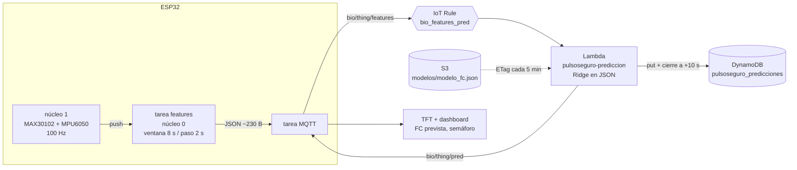

# PulsoSeguro · Predicción de FC a +10 s (Lambda + DynamoDB)

La pulsera calcula 16 features cada 2 s, una Lambda predice la FC dentro de 10 s, la guarda en DynamoDB y la devuelve a la pulsera por MQTT. Diez segundos después, la misma Lambda anota la FC **real** junto a esa predicción, así que la tabla mide sola el error del modelo en producción.



## Archivos

| Archivo | Qué hace |
|---|---|
| `modelo/features.py` | Extractor de **referencia** (Python puro + numpy, sin scipy). Define el algoritmo |
| `firmware/pulso_seguro_aws/features_fc.h` | El mismo algoritmo en C++ para el ESP32 (header-only, sin dependencias) |
| `firmware/pulso_seguro_aws/prediccion_fc.h` | Tarea FreeRTOS, cola, publicación y recepción de `/pred` |
| `firmware/pulso_seguro_aws/INTEGRACION_FIRMWARE.md` | Los 5 enganches en el `.ino` |
| `modelo/exportar_modelo.py` | Entrena Ridge con GroupKFold, lo compara con las líneas base y exporta `modelo_fc.json` |
| `lambda/src/lambda_function.py` | La Lambda (solo stdlib + boto3) |
| `lambda/test_lambda.py` | Prueba de punta a punta contra AWS simulado (moto) |
| `infra/template.yaml` · `infra/desplegar.sh` / `desplegar.ps1` | Tabla, Lambda, roles, Rule y permisos en una pila de CloudFormation (bash o PowerShell) |
| `herramientas/probar_paridad.py` + `paridad.cpp` | Compila el código del ESP32 en la PC (g++, clang++, MSVC o `ziglang`) y lo compara contra Python |
| `herramientas/simular_features.py` | Publica features desde un CSV para probar AWS sin la pulsera |
| `herramientas/mae_produccion.py` | MAE real del modelo vs. la línea base, leído de DynamoDB |
| `herramientas/sintetico.py` | Dataset sintético con transiciones (mismo formato que `cargar_s3.py`) |

## Decisiones de diseño

**Las features se calculan en el ESP32, no en la Lambda.** La Lambda recibe 16 números y hace 16 multiplicaciones: sin numpy, sin capas, arranque en frío de milisegundos. El costo es mantener dos implementaciones del extractor, y el riesgo es el *training/serving skew* (que el modelo vea en producción features calculadas distinto que en el entrenamiento). Ese riesgo se elimina con la prueba de paridad: el **mismo** `features_fc.h` que corre en el ESP32 se compila en la PC y se compara contra `features.py`.

**Por eso `features.py` no usa scipy.** `find_peaks` y `filtfilt` (con su relleno de bordes) serían difíciles de replicar exactamente en C. El extractor usa un biquad escrito a mano, una DFT directa solo en los bins de 0.5-4 Hz y una selección de picos codiciosa: todo portable línea por línea.

> ⚠ **Hay que reentrenar con este extractor.** Los resultados del 10/11 (`modelo_fc.py`) usaron otro detector. Corre `exportar_modelo.py` sobre tu `dataset.csv` real: el modelo desplegado debe salir de las mismas features que manda la pulsera.

**Lags en el ESP32.** El ESP32 recuerda sus últimas 3 ventanas y manda los lags ya calculados. La Lambda queda sin estado: cada mensaje se entiende solo, y un reintento o un mensaje fuera de orden no corrompe nada.

**DynamoDB en modo aprovisionado (5 WCU / 5 RCU).** La capa siempre gratuita cubre 25 WCU/RCU **aprovisionadas**; el modo on-demand no entra. Cada pulsera escribe ~1 WCU/s.

**Ridge con «usar» honesto.** Si en validación Ridge no le gana a la media de 3 ventanas, el JSON dice `"usar": "media3"` y la Lambda **publica la línea base**, pero sigue guardando ambas predicciones. Así el despliegue no espera al modelo: cuando reentrenes y gane, solo subes el JSON.

### Diseño de la tabla

| Atributo | Ejemplo | Para qué |
|---|---|---|
| `dispositivo` (PK) | `pulsera01` | Una partición por pulsera |
| `ts` (SK, número) | `1762900116724` | `timestamp()` de la Rule, en ms. Permite consultar rangos de tiempo (dashboard) |
| `boot`, `win` | `9f3a1c2e`, `54` | Identifican la ventana sin depender del reloj: la predicción de `win` se cierra con la ventana `win+5` del mismo `boot` |
| `fc`, `fc_prevista`, `fc_pred_modelo`, `fc_pred_base` | `66.3`, `66.27`… | La FC actual y las predicciones |
| `fc_real`, `err_modelo`, `err_base` | `65.93`, `0.34`, `0.37` | Escritos **10 s después** por la Lambda |
| `usado`, `modelo_ver`, `semaforo_pred` | `ridge`, `20261112-030721`, `verde` | Trazabilidad: qué modelo hizo cada predicción |
| `expira` | epoch s | TTL: DynamoDB borra el ítem a los 30 días (gratis) |

El cierre del ciclo es un `Query` en `ts ∈ [ahora-13 s, ahora-7 s]` filtrado por `boot` y `win-5`, seguido de un `UpdateItem` condicional. La escritura inicial usa `attribute_not_exists(ts)`, así que si IoT reintenta la invocación no se duplica nada.

### Contrato de los mensajes

```jsonc
// bio/<thing>/features   (ESP32 → AWS, solo ventanas válidas, cada 2 s)
{"v":1, "boot":"9f3a1c2e", "win":54, "t_ms":115990,
 "f":[fc, fc_fft, cv_ibi, perfusion, razon_r, acc_media, acc_std, acc_frec, gyro_std,
      fc_lag1, fc_lag2, fc_lag3, acc_std_lag1, acc_std_lag2, acc_std_lag3, tendencia]}

// bio/<thing>/pred       (Lambda → ESP32)
{"win":54, "fc":66.3, "fc_prevista":66.3, "semaforo":"verde", "modelo":"20261112-030721", "usado":"ridge"}
```

`v` es la versión del extractor. Si algún día cambias una feature, sube `VERSION_FEATURES` en ambos lados: la Lambda rechaza mensajes cuya versión no coincide con la del modelo, en vez de predecir basura en silencio.

## Paso a paso

```bash
# 0) Pruebas locales (sin AWS, sin costo)
pip install ziglang        # solo si no tienes g++/clang++/cl (p. ej. Windows): compilador C++ vía pip
python herramientas/sintetico.py -o dataset_sintetico.csv
python herramientas/probar_paridad.py dataset_sintetico.csv     # ESP32 == Python
python lambda/test_lambda.py                                    # Lambda + DynamoDB simulados

# 1) Paridad con tus datos reales y modelo
python herramientas/probar_paridad.py dataset.csv
python modelo/exportar_modelo.py dataset.csv -o modelo_fc.json

# 2) Desplegar (AWS CLI configurado)
export BUCKET=<tu bucket del dataset>
export AWS_IOT_ENDPOINT=$(aws iot describe-endpoint --endpoint-type iot:Data-ATS --query endpointAddress --output text)
./infra/desplegar.sh modelo_fc.json

# 2b) En Windows (PowerShell); el endpoint IoT se detecta solo si no lo das
#   .\infra\desplegar.ps1 -Modelo modelo_fc.json -Bucket <tu bucket>
#   .\infra\desplegar.ps1 -Modelo modelo_fc_v2.json -Bucket <tu bucket> -SoloModelo
#   Si lo bloquea la política de ejecución:
#   powershell -ExecutionPolicy Bypass -File .\infra\desplegar.ps1 -Modelo modelo_fc.json -Bucket <tu bucket>

# 3) Probar sin la pulsera (verás las respuestas de /pred en la terminal)
python herramientas/simular_features.py dataset.csv --thing <THING_PULSERA> \
  --cert certs/pc-captura.cert.pem --key certs/pc-captura.private.key --ca certs/AmazonRootCA1.pem

# 4) Ver la tabla y el error real
aws dynamodb query --table-name pulsoseguro_predicciones \
  --key-condition-expression "dispositivo = :d" \
  --expression-attribute-values '{":d":{"S":"<THING_PULSERA>"}}' --no-scan-index-forward --max-items 5
python herramientas/mae_produccion.py --thing <THING_PULSERA> --horas 1

# 5) Modelo nuevo, sin redesplegar
./infra/desplegar.sh modelo_fc_v2.json --solo-modelo
```

Ajusta los nombres de `certs/` a los que usa tu `control.py`. La pila se borra completa con `aws cloudformation delete-stack --stack-name pulsoseguro-prediccion` (también borra la tabla).

## Costo por pulsera y hora con el dedo puesto

| Recurso | Uso | Comentario |
|---|---|---|
| IoT Core | ~1 800 mensajes `features` + ~1 800 `pred` publicados + ~1 800 entregados | **≈ 5 400 mensajes/h más**, sumados a los ~4 800 de los lotes. Es lo que más pesa frente al límite de 500 mil: ~50 h/mes con ambos flujos activos |
| Rule | ~1 800 acciones Lambda | |
| Lambda | ~1 800 invocaciones de ~50 ms a 128 MB | El millón gratuito al mes alcanza para ~550 h |
| DynamoDB | ~1 WCU/s, ~0.6 MB/h | Dentro de 25 WCU y 25 GB; el TTL controla el tamaño |
| CloudWatch Logs | Una línea por invocación | Retención de 14 días |

Si los mensajes se vuelven el límite: publica features solo durante sesiones de monitoreo, o pasa la inferencia al ESP32 (el mismo JSON sirve: son 16 multiplicaciones).

## Si algo no funciona

| Síntoma | Dónde mirar |
|---|---|
| Llegan features pero no hay ítems en la tabla | Log group `/pulsoseguro/errores-regla` (la Rule no pudo invocar la Lambda) y `/aws/lambda/pulsoseguro-prediccion` |
| `descartado … version de features` | El firmware y el modelo usan `VERSION_FEATURES` distintas |
| `descartado … vector de features inválido` | El JSON llegó cortado: revisa `setBufferSize` y el tamaño de `Msg::json` |
| `AccessDenied` en `HeadObject` | El JSON no está en `s3://$BUCKET/modelos/modelo_fc.json` (S3 responde 403 en vez de 404 sin `ListBucket`) |
| Hay predicciones pero `fc_real` nunca aparece | Debe haber ventanas válidas 10 s después; con el sensor flojo casi no las hay. Revisa el % de válidas en el log |
| El ESP32 no recibe `/pred` | La suscripción se hace al reconectar; el `cmd` y el `pred` comparten el callback |
